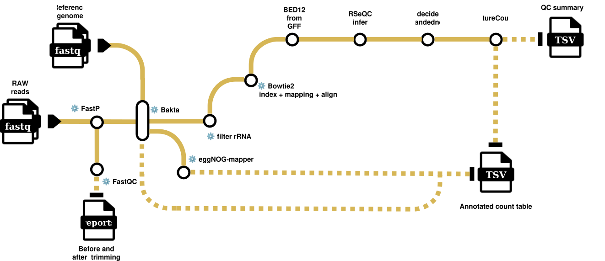

# DEFINE

**D**ifferential **E**xpression, **F**unctional **I**nterpretation & **N**etwork **E**nrichment

Differential expression for a single organism: RNA-seq reads against a reference
genome, ending at an annotated count table. 17 rules across 9 tool environments.

> **This page is not written yet.** The workflow diagram is still to be drawn,
> and this document will be filled in alongside it. Until then, the stage-level
> summary in [`README.md`](README.md#define--differential-expression) is
> accurate and current.

<!-- Diagram goes here once drawn, same form as the other pipelines:

  

Then the sections the other pages use: what it takes in, what it produces, the
stages one by one, what the Plots tab does with it, and the requirements.
Stage names and rules can be read straight from
pipelines/define/workflow/rules/*.smk -- writing them from the rules rather
than from memory is what keeps these pages true.
-->
