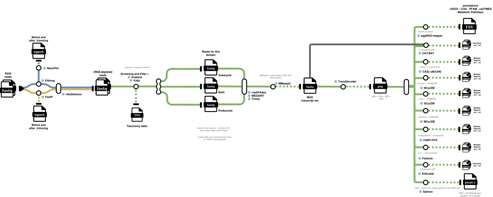

# DOGMA

**D**iversity **O**f **G**ene expression — **M**etatranscriptome **A**nalysis

Metatranscriptomics: not who is in a community, but what it is doing. 34 rules
across 18 tool environments.

  

---

## What it takes in

RNA reads from a community — short, long, or both. Where MAGMA asks which
organisms are present, DOGMA asks which genes are being transcribed, and by
whom.

## What it produces

| | |
|---|---|
| Transcriptome | assembled de novo, per sample |
| ORFs | predicted from the transcripts |
| Function | across six annotation vocabularies |
| Taxonomy | prokaryotic and eukaryotic, separately |
| Quantification | per-transcript read counts |
| Genome linkage | optional cross-reference to a MAGMA run's MAGs |

---

## The stages

### 01 — Read QC and rRNA removal

`fastp` · `filtlong` · `ribodetector_short` · `ribodetector_long` ·
`nanoplot_raw` · `nanoplot_clean`

Cleaning branches on read type, then **RiboDetector removes ribosomal RNA**.
This is not optional housekeeping: rRNA can dominate a total-RNA library, and
leaving it in distorts every downstream normalisation — the expression of every
real gene would be measured against a denominator that is mostly rRNA.

### 02 — Screening and domain separation

`kraken2` · `kaiju_classify` · `kaiju_table` · `extract_domain_short` ·
`extract_domain_long`

Reads are classified and then **split by domain**. Everything downstream runs
per sample *and* per domain, because a prokaryotic and a eukaryotic
transcriptome need different assemblers, different ORF callers and different
taxonomic references. Treating them as one dataset produces an assembly that
serves neither well.

### 03 — Assembly

`rnaspades` · `megahit` · `trinity` · `transcript_set`

Three assemblers available; `transcript_set` normalises whichever ran.

> **Trinity dominates this pipeline's memory requirement.** Its own documented
> rule of thumb is roughly **1 GB of RAM per 1 million reads**, so requirements
> scale almost linearly with sequencing depth. MEGAHIT is the lighter
> alternative on constrained hardware.

### 04 — ORF calling

`transdecoder`

TransDecoder predicts coding regions from the assembled transcripts. Its ORF
identifiers (`{transcript}.p1`) are the key everything in stage 05 joins on.

### 05 — Functional annotation

`eggnog_sample` · `cazy_annotate` · `ncycdb_*` · `mcycdb_*` · `scycdb_*` ·
`canthyd_annotate` · `fegenie_annotate`

Six vocabularies, each answering a different question:

| Tool | Answers |
|---|---|
| eggNOG-mapper | broad function — COG, KEGG, GO, EC, PFAM, CAZy |
| dbCAN | carbohydrate-active enzymes, in detail |
| NCycDB / SCycDB / MCycDB | nitrogen, sulfur and methane cycling genes |
| CANT-HYD | hydrocarbon degradation |
| FeGenie | iron acquisition and metabolism |

The cycling databases and FeGenie exist because environmental metatranscriptomics
usually asks a biogeochemical question, and a generic functional annotation
answers it only obliquely.

### 06 — Taxonomy

`eukulele_setup` · `eukulele_annotate` · `cat_setup` · `cat_annotate`

CAT/BAT for prokaryotic transcripts, EUKulele for eukaryotic — the pairing the
domain split in stage 02 exists to enable.

> CAT/BAT's lineage strings here are **NCBI taxids**, not readable names: the
> pipeline does not run `CAT_pack add_names`. That is why the Plots tab treats
> `catbat_lineage` as one opaque value and never splits it into ranks.

### 07 — Quantification

`salmon_index` · `salmon_quant`

Salmon quantifies against the sample's own assembled transcripts.

> **Salmon is keyed by transcript, while annotation is keyed by ORF.** A
> transcript can yield several ORFs, so the join is one-to-many — which is why
> DOGMA's Plots-tab representation is a long per-ORF table rather than the
> matrix shape the other pipelines use.

### 08 — MAGMA cross-reference (optional)

`magma_mag_db` · `magma_mag_annotate`

If a MAGMA run exists for the same material, this stage maps DOGMA's ORFs
against that run's MAGs via DIAMOND and joins each hit to the MAG's GTDB-Tk
classification. The result is **genome-resolved expression**: not just "this
function is being transcribed" but "this recovered organism is transcribing
it" — which a public reference database cannot tell you, because it does not
contain the organisms actually present at your site.

Requires pointing the "MAGMA Run" database entry at a finished MAGMA output
folder.

---

## In the Plots tab

9 analyses over a per-ORF long table: functional composition across any of the
annotation vocabularies, differential expression by gene family, sample
ordination and distance, MA plots, DE heatmaps and UpSet intersections.

**One design point worth knowing when reading the results.** A gene annotated
`ko00010,ko00020,map00010,map00020` was once counted as a single gene family
literally named that whole string, so no two genes sharing a pathway ever
grouped together. Terms are now expanded per vocabulary: COG letters are split
individually (`EJ` means both E and J), comma-separated lists are split, and
KEGG's duplicate `map` namespace is dropped so pathways are not counted twice.
Lineage strings are deliberately **not** split.

---

## Requirements

**32 GB minimum, 64–128 GB recommended**, driven by Trinity and therefore by
sequencing depth. Needs **AVX2** if MMseqs2 is enabled. Full figures in
[`../REQUIREMENTS.md`](../REQUIREMENTS.md).
