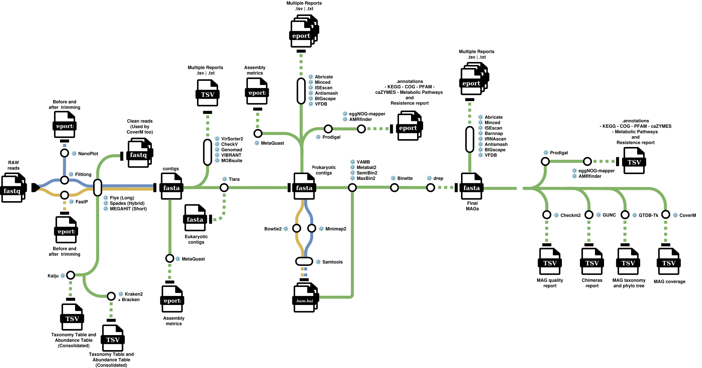

# MAGMA

**M**etagenome **A**ssisted **G**UI & **M**AG **A**nalyses

Shotgun metagenomics: who is in a community, and can their genomes be recovered
from it. The largest of the five pipelines — 62 rules across 35 tool
environments — and the most demanding to run.

  

---

## What it takes in

Short reads (Illumina), long reads (ONT/PacBio), or both for a hybrid assembly.
Read type is declared per sample, and the pipeline branches on it from the very
first stage rather than assuming one platform.

## What it produces

| | |
|---|---|
| Community profile | two independent read-level classifications |
| Assembly | contigs, with a prokaryote-only subset |
| MAGs | dereplicated, quality-assessed, taxonomically classified |
| Annotation | function, resistance, virulence, mobile elements, secondary metabolites |
| Abundance | per-MAG coverage across every sample |

---

## The stages

### 01 — Read QC and taxonomic profiling

`fastp` · `filtlong` · `nanoplot_raw` · `nanoplot_clean` · `kraken2` ·
`bracken` · `kreport2mpa` · `consolidate_taxonomy` · `kaiju_classify` ·
`kaiju_table` · `consolidate_taxonomy_kaiju`

Cleaning branches on read type: fastp for short reads, filtlong plus NanoPlot
for long. A sample gets whichever applies, never both.

**Two classifiers run independently, and this is deliberate.** Kraken2 matches
nucleotide k-mers; Kaiju translates the reads and matches proteins. They are
not interchangeable — Kaiju tends to assign more reads where there is
taxonomic novelty, because amino-acid similarity survives more sequence
divergence than nucleotide k-mer matching does. Each gets its own consolidated
abundance table, and the Plots tab can show either or compare them. Agreement
between two independent methods is itself evidence, not merely a choice between
them.

### 02 — Assembly

`megahit` · `metaspades_hybrid` · `flye` · `finalize_assembly` · `metaquast` ·
`tiara` · `filter_prokaryotes` · `metaquast_prokaryotic`

MEGAHIT or metaSPAdes for short and hybrid data, Flye for long reads.
`finalize_assembly` normalises whichever ran into one path, so everything
downstream is platform-agnostic.

**Tiara then splits prokaryotic from eukaryotic contigs**, and MetaQUAST runs
twice: once on the full assembly and once on the prokaryotic subset. The gap
between the two is itself a result — it says how much of the assembly was set
aside before binning.

### 03 — Mapping

`bowtie2_index` · `map_reads` · `index_bam` · `calculate_depth`

Reads back against the assembly. The point is the per-contig depth profile:
binning separates genomes largely by co-abundance across samples, and this is
where that signal comes from.

### 04 — Binning

`metabat2` · `semibin2` · `maxbin2` · `vamb`

Several binners over the same assembly, in parallel. They disagree, and that is
the point — the next stage exploits the disagreement rather than picking a
winner in advance.

### 05 — MAG refinement and quality

`binette` · `checkm2` · `gunc`

Binette consolidates the bin sets into one refined set. Then two independent
quality checks:

- **CheckM2** measures completeness and contamination from single-copy marker
  genes.
- **GUNC** asks whether the genes in a bin agree on one lineage.

**They are reported side by side and never merged.** A chimera of two organisms
with complementary marker sets scores well on both of CheckM2's axes while
being two genomes spliced together; GUNC is what catches it. A MAG can pass one
and fail the other, and collapsing them into a single "quality" number would
hide exactly the case worth seeing.

### 06 — Dereplication and taxonomy

`pool_hq_mags` · `drep` · `gtdbtk`

High-quality MAGs are pooled across samples, dereplicated with dRep so the same
organism recovered from several samples becomes one genome, and classified with
GTDB-Tk.

> **GTDB-Tk sets this pipeline's memory floor: 150 GB**, per its own
> documentation. Everything else in MAGMA runs comfortably below that. On
> constrained hardware this stage can be disabled — read-level taxonomy from
> stage 01 remains.

### 07 — Annotation and mobilome

Run twice, over two different things: **per sample** (the whole assembled
metagenome) and **per MAG** (one recovered genome each).

| | Tools |
|---|---|
| Genes and function | `prodigal` · `eggnog` |
| Resistance and virulence | `amrfinder` · `abricate` · `vfdb` |
| Non-coding and structural | `barrnap` · `trnascan` · `minced` |
| Mobile elements | `mobsuite` (plasmids) · `isescan` (insertion sequences) |
| Viral | `genomad` · `virsorter2` · `checkv` · `vibrant` |
| Secondary metabolites | `antismash` · `bigscape` |

The two levels answer different questions. Per sample is the community's whole
gene content; per MAG is what one organism carries. Both are kept, and the
Plots tab keeps their denominators separate.

**Gene calling happens once, in Pyrodigal, and everything reuses it.** Pyrodigal
is a Cython binding to Prodigal's own internals — validated to reproduce Prodigal
v2.6.3 exactly — but it threads properly, so the thread count is a real setting
rather than a decoration. It runs `-p meta` on the assembly and `-p single` on
each MAG, which is the distinction that matters: a metagenome and a single genome
need different models.

> **antiSMASH is given those gene calls instead of predicting its own.** Its
> bundled gene finding runs Prodigal in single-genome mode, which is the wrong
> model for an assembled metagenome; both antiSMASH rules now pass Pyrodigal's
> GFF3 through `--genefinding-gff3`. The BGCs therefore sit on the same ORFs as
> the rest of stage 07, and came from the metagenomic model where that is what
> the input is.

### 08 — Coverage

`coverm_index` · `coverm_map_short` · `coverm_map_long` · `coverm`

Every MAG quantified across every sample, which is what turns a set of recovered
genomes into a comparative dataset.

---

## In the Plots tab

17 analyses. Community composition and diversity from either classifier or both;
MAG quality against the MIMAG standard with GUNC alongside; functional
composition at sample or MAG level; read-QC and assembly metrics; differential
abundance by pairwise contrast or likelihood ratio test.

---

## Requirements

The most demanding pipeline of the five. **150+ GB RAM** with GTDB-Tk enabled,
**64 GB** minimum without it, and a CPU with **AVX2** (CheckM2 and SemiBin2
abort without it). Full figures in [`../REQUIREMENTS.md`](../REQUIREMENTS.md).

## Pairs with DOGMA

A DOGMA run over RNA from the same material can cross-reference its transcripts
against this run's MAGs, giving genome-resolved expression. See
[`DOGMA.md`](DOGMA.md), stage 08.
