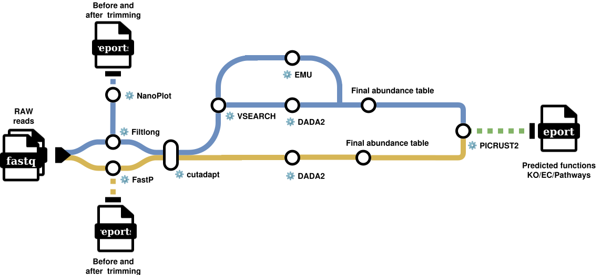

# PRISM

**P**rofiling **r**RNA **I**nference of **S**pecies via **M**etabarcoding

Amplicon sequencing: community profiling from 16S, 18S, 23S/28S, ITS, the
full 16S-ITS-23S rrn operon, COI or 12S marker genes, on short (Illumina) and
long (ONT/PacBio) read platforms. 16 rules across 6 tool environments.

  

---

## What it takes in

Amplicon reads — short paired-end Illumina, or long ONT/PacBio HiFi reads —
plus a marker-gene choice. An **amplicon preset** ties the gene, its primer
pair and its expected length window together as one selection, so the three
never drift out of agreement with each other.

## What it produces

| | |
|---|---|
| Denoised sequences | ASVs (DADA2 paths) or reference-matched taxa (Emu/ONT path) |
| Taxonomy | per sequence, down to the gene's own practical resolution |
| Abundance table | one consolidated table regardless of which engine ran |
| Phylogenetic tree | for UniFrac/weighted UniFrac in the Plots tab |
| Function (optional) | PICRUSt2 predicted KO/EC/pathway abundance |

---

## The stages

### 01 — QC and trimming

`fastp` · `nanoplot_raw` · `filtlong` · `nanoplot_clean`

Branches on read type: `fastp` for short reads, `NanoPlot` before and after
`Filtlong` length/quality filtering for long reads. The length window
Filtlong applies comes from the run's amplicon preset by default — a 16S
window silently discards an entire ITS or full rrn-operon run if left at a
16S-tuned default, so the preset supplies the right one automatically.

### 02 — Primer removal

`cutadapt_trim` · `cutadapt_trim_short`

Long reads carry both primers on the same read, so `cutadapt` uses a
**linked adapter** (forward…reverse-complement(reverse)) to trim both ends
and orient the read in one pass. Short paired reads carry one primer each,
trimmed separately per mate. Either path also accepts a **primer mix**, not
just a single pair — ONT's own 16S kit pools a universal pair with several
taxon-specific ones, and every forward/reverse combination is tried.

### 03 — Chimera filtering (long reads only)

`vsearch_cluster` · `vsearch_chimera`

> **Why clustering happens before chimera detection.** Running
> `uchime_denovo` directly on raw long reads found zero chimeras, including
> one deliberately planted for testing — not a false-positive problem, the
> opposite one: raw noisy long reads essentially never exact-duplicate, so
> every "dereplicated" sequence has abundance 1 and the algorithm's
> abundance-skew logic has nothing to work with. Clustering at 95% identity
> first gives real abundance-weighted clusters (same-species reads at a
> realistic long-read error rate still cluster together; different species
> stay well apart), which chimera detection actually needs.

Short reads skip this stage entirely: DADA2's own `removeBimeraDenovo()`
handles chimera removal downstream, using the exact-dereplication abundance
signal that short reads, unlike raw long reads, provide reliably.

### 04 — Denoising and classification

`dada2_pacbio` · `emu_build_db` · `emu_classify` · `join_emu` · `emu_tree` ·
`dada2_illumina` · `select_abundance_table`

Three engines, chosen by platform, each producing the same final shape:

| Platform | Engine | Why |
|---|---|---|
| PacBio HiFi | DADA2 (cohort-level ASVs) | HiFi's accuracy supports true ASV inference |
| ONT | Emu (expectation-maximization against a reference) | ONT's error rate is too high for ASV calling; Emu classifies against a database instead |
| Illumina | DADA2 (paired-end ASVs) | the textbook DADA2 workflow |

`select_abundance_table` then picks whichever engine actually produced
output for the run's platform, so every downstream step — including the
Plots tab — always reads from one stable path regardless of which one ran.

### 05 — Functional inference (optional)

`picrust2`

Predicts KO/EC/pathway abundance from the PacBio/DADA2 path's ASVs, scoped
deliberately to 16S: PICRUSt2's bundled reference tree is bacterial/archaeal
only, and the ONT/Emu path has no per-sample consensus sequence for it to
phylogenetically place in the first place. Disabled by default.

---

## In the Plots tab

13 analyses over the consolidated abundance table: Good's coverage and
rarefaction curves for sequencing-depth adequacy, alpha and beta diversity,
taxonomic composition, core microbiome, co-occurrence networks and indicator
species, DESeq2 and LRT differential abundance, RDA against environmental
drivers, and Venn/UpSet set comparisons.

**PRISM is the only pipeline that builds a phylogenetic tree** (from
matched reference sequences on the Emu/ONT path, from the ASVs themselves on
either DADA2 path) — which is what makes UniFrac and weighted UniFrac
available here specifically. Every other pipeline's community table is
lineage-collapsed with no placed sequences, so those distances are refused
there with an explanation rather than silently substituted.

---

## Requirements

**8 GB minimum, 16–32 GB recommended**, driven by DADA2's error model, which
grows with cohort size. PICRUSt2 (optional, off by default) is the one step
that can exceed the rest. No AVX2 requirement. Full figures in
[`../REQUIREMENTS.md`](../REQUIREMENTS.md).
