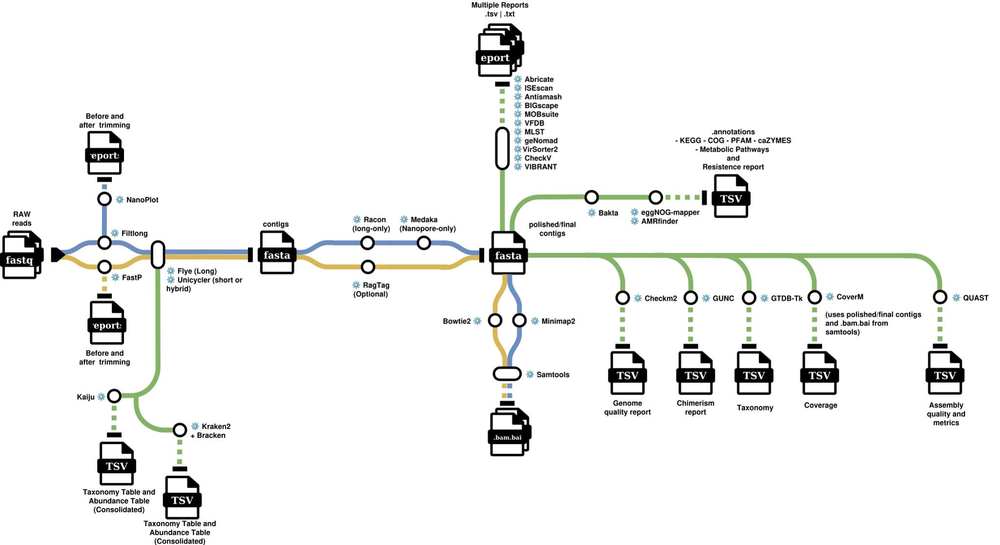

# SIGMA

**S**ingle **I**solate **G**enome, **M**ulti-platform **A**ssembly

Isolate genomics: you sequenced cultured organisms, and want to know what they
are and what they carry. 36 rules across 28 tool environments.

  

---

## What it takes in

Reads from one or more isolates — short, long, or both. Each sample is one
organism, which is the assumption that separates SIGMA from MAGMA: there is no
binning here, because there is nothing to separate.

## What it produces

| | |
|---|---|
| Assembly | polished, optionally scaffolded |
| Quality | QUAST metrics, CheckM2, GUNC |
| Identity | GTDB-Tk classification, MLST sequence type |
| Annotation | full genome annotation plus function |
| Resistome and virulome | AMR and virulence genes with coordinates |
| Mobilome | plasmids, prophages, insertion sequences |
| Secondary metabolites | biosynthetic gene clusters |

---

## The stages

### 01 — Read QC

`fastp` · `filtlong` · `nanoplot_raw` · `nanoplot_clean`

Same branch-on-read-type logic as every other pipeline. Because a SIGMA genome
comes from one sample's reads, this stage is the direct upstream explanation for
a fragmented assembly later — which is why the Plots tab surfaces it.

### 02 — Assembly

`unicycler` · `flye` · `finalize_assembly`

Unicycler for short and hybrid input, Flye for long-read-only.
`finalize_assembly` normalises the result so the rest of the pipeline does not
branch again.

### 03 — Polishing

`racon_polish` · `medaka_polish` · `ragtag_scaffold` · `finalize_polish`

Long-read assemblies carry systematic error that polishing removes: Racon then
Medaka. RagTag optionally scaffolds against a reference. The output is
`final_polished.fa`, which every later stage reads — including the Plots tab's
genome ring, which lays its contigs out on the real lengths from this file.

### 04, 07 — Mapping and coverage

`bowtie2_index` · `map_reads` · `index_bam` → `coverm`

Reads back against the polished assembly, then CoverM for depth.

> A quirk worth knowing: **CoverM bakes the sample name into its column
> headers** and reports the genome itself as the literal string
> `final_polished`, the same for every sample. QUAST does the same in its own
> `Assembly` column. Neither can be used as a join key, which is why the Plots
> tab keys everything off the sample directory instead.

### 05 — Quality

`quast` · `checkm2` · `gunc`

Assembly contiguity from QUAST; completeness and contamination from CheckM2;
lineage coherence from GUNC. As in MAGMA, **CheckM2 and GUNC are reported side
by side, never merged** — a chimeric assembly can score perfectly on both of
CheckM2's axes. In the Plots tab, GUNC failure appears as the point shape on
the quality overview, so a genome sitting inside the high-quality region while
failing GUNC is visible rather than buried in a second figure.

### 06 — Taxonomy

`gtdbtk`

GTDB-Tk writes exactly one of `gtdbtk.bac120.summary.tsv` or
`gtdbtk.ar53.summary.tsv` per genome, depending on domain. As in MAGMA, this
stage sets the memory floor at **150 GB** and can be disabled.

### 08 — Annotation

`bakta` · `eggnog_sample` · `amrfinder_sample` · `abricate_sample` ·
`vfdb_sample` · `isescan_sample` · `mobsuite_sample`

**Bakta is the centrepiece**: gene calling, tRNA, rRNA, ncRNA and CRISPR
detection, and functional annotation, all in one step. Its per-feature TSV is
what the genome ring draws almost every track from. eggNOG-mapper is available
on top for deeper orthology-based profiling.

AMRFinderPlus and ABRicate (NCBI, CARD, VFDB) cover resistance and virulence.
MOB-suite reconstructs plasmids; ISEScan finds insertion sequences.

> **MOB-suite reports contigs by their full FASTA header**, description
> included, while AMRFinder and ABRicate report only the first token. Joining
> the two on the raw value matches nothing and produces an empty figure with no
> error — the Plots tab cuts both to the first token and reports the match rate
> so a mismatch is visible rather than silent.

### 09 — Typing

`mlst`

Sequence type against PubMLST. A genome with no matching scheme reports a
literal `-`, which is a real result ("no scheme applies to this organism"), not
missing data.

### 10 — Viral

`genomad` · `virsorter2` · `checkv` · `vibrant`

Prophages and viral contigs. geNomad reports coordinates, which is what lets the
genome ring place prophages on the map; CheckV assigns each one a completeness
tier.

### 11 — Secondary metabolites

`antismash` · `bigscape`

antiSMASH finds biosynthetic gene clusters; BiG-SCAPE groups them into gene
cluster families, which is what makes "shared across genomes" versus "unique to
this one" answerable.

### 12 — Screening

`kraken2` · `kaiju_classify` · `kaiju_table`

Read-level classification as a contamination check — an isolate library that is
not what it should be shows up here before anything downstream is trusted.

---

## In the Plots tab

7 analyses, including two that exist only for SIGMA:

- **Genome ring** — the circular map, Proksee-style, with toggleable tracks for
  CDS by strand, rRNA/tRNA, CRISPR, AMR, BGCs, prophages, insertion sequences,
  GC content and GC skew.
- **Mobilome** — including the view that crosses AMR hits against MOB-suite's
  chromosome-versus-plasmid call, which is what tells you whether a resistance
  gene can move between species.

---

## Requirements

**150+ GB RAM** with GTDB-Tk, **16–32 GB** without it. Needs **AVX2** (CheckM2,
and medaka on the long-read path). Full figures in
[`../REQUIREMENTS.md`](../REQUIREMENTS.md).
